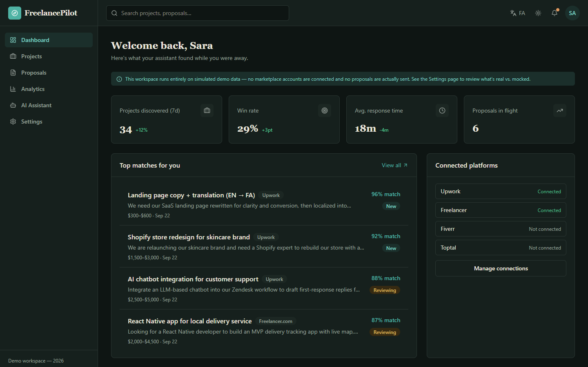
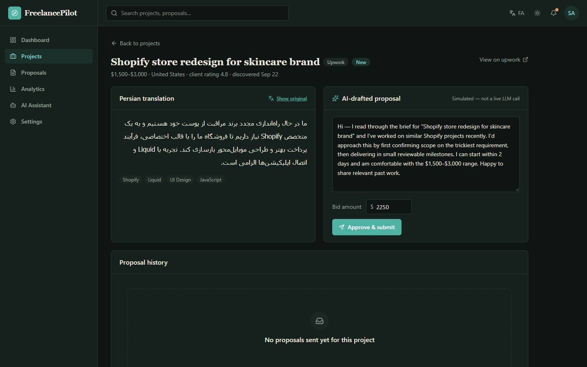
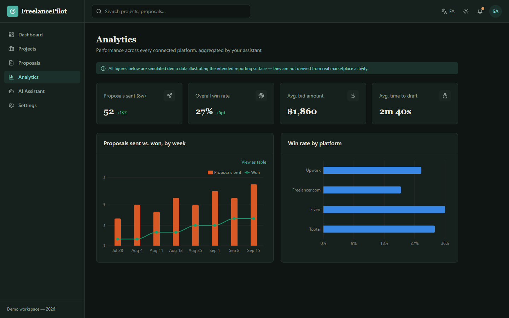
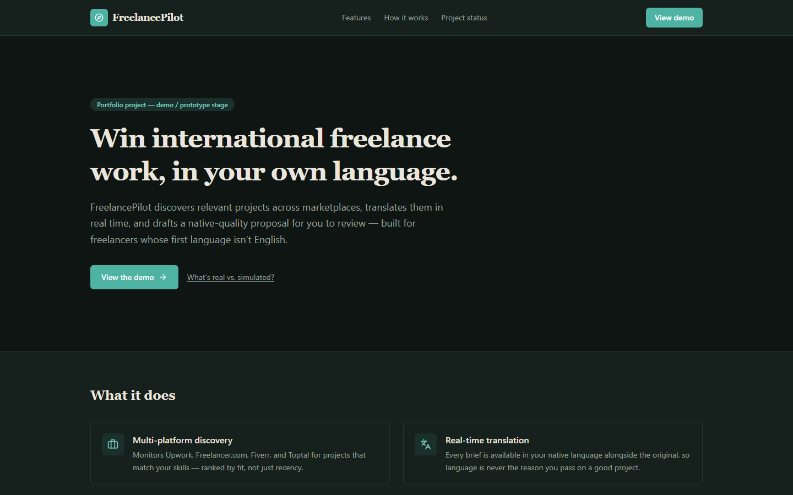
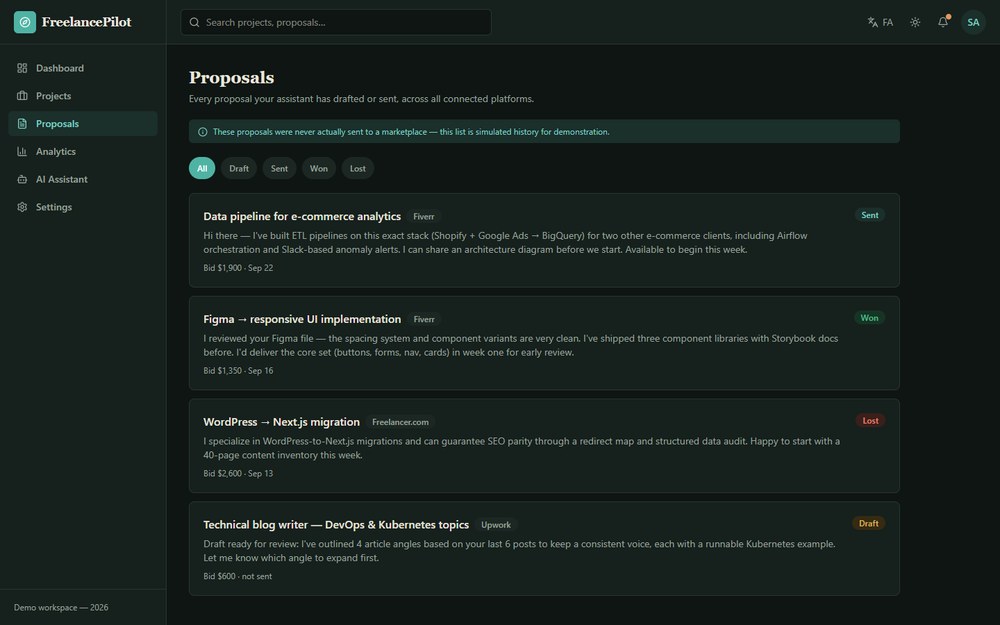
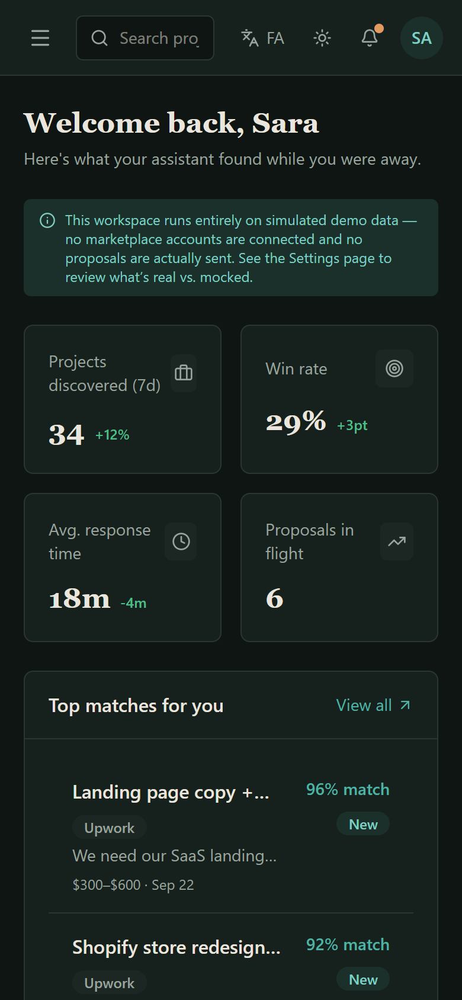

# FreelancePilot

**Win international freelance work in your own language: find matching projects across marketplaces, read them translated, and send a polished proposal you approve.**

**Status: Demo / Prototype — portfolio project, not an active product.**
Every claim below is qualified with what's real vs. simulated. See
[`docs/LIMITATIONS.md`](docs/LIMITATIONS.md) for the exhaustive breakdown —
that file is the source of truth if anything here seems to overstate it.

An AI-copilot concept for freelancers whose first language isn't English:
discover projects across marketplaces, read them translated into your own
language, and send a native-quality proposal — with a human always
reviewing and approving before anything goes out.



## Problem

Freelancers competing on international marketplaces (Upwork, Freelancer.com,
Fiverr, Toptal) lose time monitoring multiple platforms by hand, and lose
winnable work to language friction when English isn't their first language.
Existing marketplace AI tools are single-platform and don't address
translation at all.

## Solution (as demonstrated here)

A single workspace that ranks incoming projects by skill match, shows the
original brief next to a translation, drafts a proposal you can edit, and
only sends it when you click approve. The demo simulates every backend
interaction (see status table below) but the full interaction design —
what a user would actually click through — is real and working.

## Features

| Feature | Page |
|---|---|
| Skill-matched project feed, filterable by platform/status/search | `/projects` |
| Original text ⇄ Persian translation toggle, full RTL | `/projects/[id]` |
| Editable AI-drafted proposal + bid, human-approved send | `/projects/[id]` |
| Proposal history with status tracking | `/proposals` |
| Win-rate / volume analytics, accessibility-validated charts | `/analytics` |
| Skills, platform connections, language, AI preference | `/settings` |
| Conversational assistant over the current workspace | `/assistant` |
| Full EN/FA localization with RTL layout mirroring, dark mode, mobile nav | app-wide |

## Screenshots

| Project brief with Persian translation + editable AI-drafted proposal | Analytics |
|---|---|
|  |  |
| **Landing page** | **Proposals** |
|  |  |

<p>
  
</p>

*Phone-sized screen (390 px wide). Screenshots use the dark theme; the app also has a light theme.*

*Captured from the demo running locally. Projects, proposals and metrics are mock data; translation and proposal drafting are simulated — see [Honest status](#honest-status).*

## Demo

```bash
npm install
npm run dev
```

Open http://localhost:3000. Login accepts any input (see
[`docs/DEMO.md`](docs/DEMO.md) for a guided walkthrough and demo
credentials).

## Architecture

Next.js frontend over a typed mock data layer — no server, no database, no
external network calls. The data layer is designed so a real backend could
be swapped in without reshaping any page. Full diagram and the proposed
production architecture: [`docs/ARCHITECTURE.md`](docs/ARCHITECTURE.md).

## Tech stack

Next.js 16 (App Router) · React 19 · TypeScript · Tailwind CSS v4 ·
Recharts · lucide-react. No backend, no database, no external APIs — see
[Honest status](#honest-status).

## Installation

Requires Node.js 20+.

```bash
npm install
npm run dev      # http://localhost:3000
npm run build    # production build
npm run lint
```

## Environment variables

None required. See [`.env.example`](.env.example) for what a real backend
would introduce.

## Project structure

```
src/
  app/
    page.tsx                 marketing landing page
    login/                   demo login (no real auth)
    (app)/                   authenticated shell: dashboard, projects, proposals, analytics, settings, assistant
  components/
    ui/                      Button, Card, Badge, Skeleton, EmptyState, Toast, StatCard
    layout/                  Sidebar, Topbar, AppShell (incl. mobile nav drawer), DemoBanner
    charts/                  WeeklyTrendChart, PlatformBarChart
    marketing/                landing-page header/footer
  lib/
    data/                    typed mock data + accessor functions (the "backend boundary" — see ARCHITECTURE.md)
    i18n/                    EN/FA dictionary + locale context
    theme-context.tsx         light/dark theme
docs/                        full documentation suite (see below)
```

## API

No API exists in this demo. The contract a real backend would expose (so
the frontend needs zero reshaping) is specified in
[`docs/API_SPEC.md`](docs/API_SPEC.md).

## Security

No backend, no auth, no stored user data, no third-party network calls —
see the full review in [`docs/SECURITY.md`](docs/SECURITY.md), including
what a real backend would require.

## Roadmap

Demo → real single-platform MVP → multi-platform → scale-readiness. Full
detail: [`docs/ROADMAP.md`](docs/ROADMAP.md).

## Limitations

[`docs/LIMITATIONS.md`](docs/LIMITATIONS.md) — read this before taking
anything else in this README at face value.

## Documentation index

[Project context](docs/PROJECT_CONTEXT.md) ·
[Product requirements](docs/PRODUCT_REQUIREMENTS.md) ·
[Architecture](docs/ARCHITECTURE.md) ·
[User flows](docs/USER_FLOWS.md) ·
[API spec](docs/API_SPEC.md) ·
[Data model](docs/DATA_MODEL.md) ·
[Security](docs/SECURITY.md) ·
[Roadmap](docs/ROADMAP.md) ·
[Decisions log](docs/DECISIONS.md) ·
[Demo guide](docs/DEMO.md) ·
[Deployment](docs/DEPLOYMENT.md) ·
[Testing](docs/TESTING.md) ·
[Limitations](docs/LIMITATIONS.md) ·
[Changelog](CHANGELOG.md)

---

## Portfolio case study

**What I built:** a frontend-complete product demo for a translation-first
freelance assistant — nine pages, a bilingual (EN/FA) RTL-aware UI, dark
mode, a validated accessible chart palette, and a typed mock-data
architecture designed as a real API boundary rather than throwaway sample
data.

**Problem:** freelancers whose first language isn't English lose winnable
international work to language friction and multi-platform overhead.

**Approach:** rather than build the original concept's full microservices
design speculatively (see [`docs/DECISIONS.md`](docs/DECISIONS.md) D1),
I scoped this to what a demo can honestly show — the product experience —
and documented the production architecture as a clearly-labeled proposal.
Every simulated interaction (translation, AI drafting, submission) is
disclosed in-product via a demo banner, not hidden behind polish.

**Key features:** side-by-side original/translation review with full RTL
layout mirroring (not just RTL text — the whole app, including chart
legends and iconography, mirrors); human-in-the-loop proposal approval;
an accessibility-validated data-viz palette (colorblind-safe pairs, table
fallback for a contrast warning); a mobile navigation drawer added after
manual testing caught the desktop-only sidebar leaving phones unusable.

**Technical/product decisions worth noting:** see
[`docs/DECISIONS.md`](docs/DECISIONS.md) for the full ADR-style log,
including a real hydration bug (server/client timestamp divergence) found
and fixed during testing, and why Google Fonts were dropped for system
font stacks (no build-time network access in the sandbox this was built
in).

**Current status:** Demo / Prototype. See
[Honest status](#honest-status) below.

**Limitations:** no real backend, no real marketplace integration, no real
AI calls — everything is disclosed in
[`docs/LIMITATIONS.md`](docs/LIMITATIONS.md).

**Future roadmap:** [`docs/ROADMAP.md`](docs/ROADMAP.md).

## Business & product overview

- **Problem:** non-native-English freelancers are structurally
  disadvantaged on English-first marketplaces.
- **Target customer:** individual freelancers on Upwork, Freelancer.com,
  Fiverr, and Toptal whose first language isn't English — Persian-speaking
  freelancers specifically, initially.
- **Solution:** a single workspace for discovery, translation, drafting,
  and human-approved submission.
- **Product workflow:** see [`docs/USER_FLOWS.md`](docs/USER_FLOWS.md).
- **Differentiation:** translation-first review (not just proposal
  generation) and human-in-the-loop send, versus single-platform,
  English-only competitor tools.
- **Monetization possibility:** a per-seat subscription is the most likely
  model for an individual-freelancer tool, but this has not been validated
  with real users or pricing research — it's a plausible direction, not a
  decision.
- **Scalability:** the architecture is designed to scale (see
  [`docs/ARCHITECTURE.md`](docs/ARCHITECTURE.md)), but nothing about
  current scale has been tested since nothing is deployed.
- **Current stage:** Demo / Prototype. No users, no revenue, no funding.

## Demo credentials

Login accepts any input — nothing is checked. Pre-filled with
`demo@freelancepilot.app` / `demo-pass`. There is no real account system;
see [`docs/LIMITATIONS.md`](docs/LIMITATIONS.md).

## Honest status

| Layer | Status |
|---|---|
| UI/UX, layout, responsiveness, i18n/RTL, dark mode | **REAL** |
| Project/proposal/user data | **MOCKED** |
| Marketplace discovery, translation, AI drafting, submission | **SIMULATED** |
| Production architecture (microservices, real API, real DB) | **PROPOSED**, not built |
| Payments/payouts, marketplace auth bypass | **NOT IMPLEMENTED** — see [`docs/ARCHITECTURE.md`](docs/ARCHITECTURE.md#open-risks-carried-over-from-the-original-concept) for why |

Full breakdown: [`docs/LIMITATIONS.md`](docs/LIMITATIONS.md).

## License

MIT — see [`LICENSE`](LICENSE).
